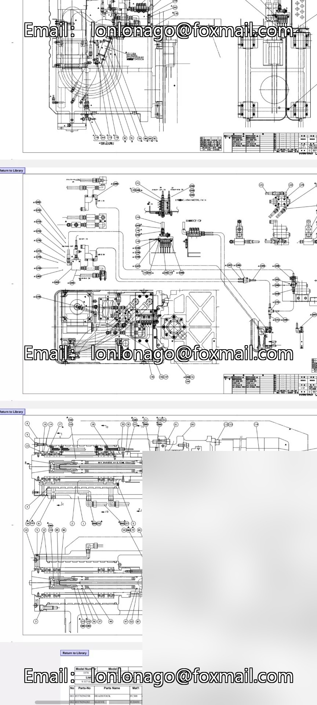
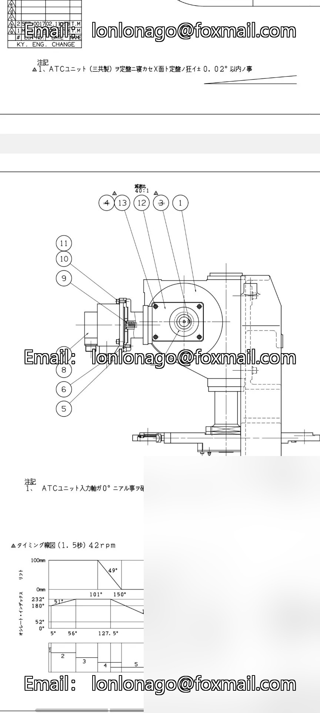
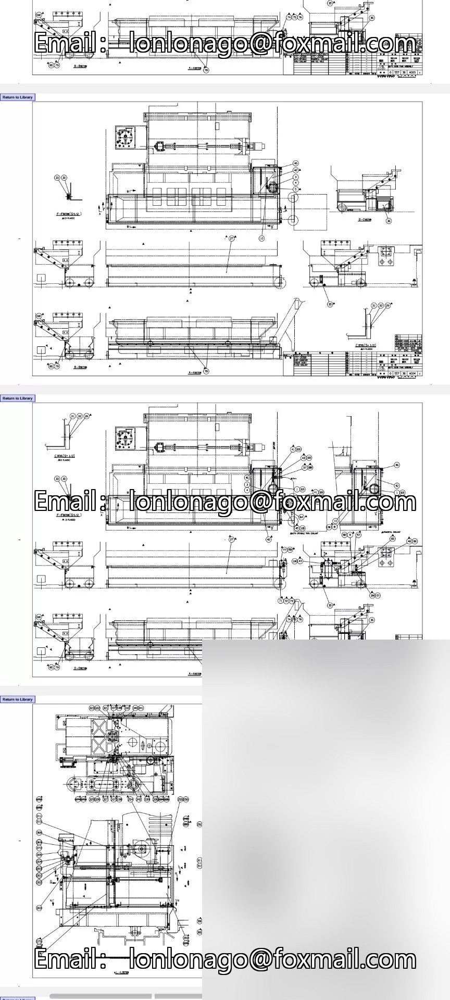
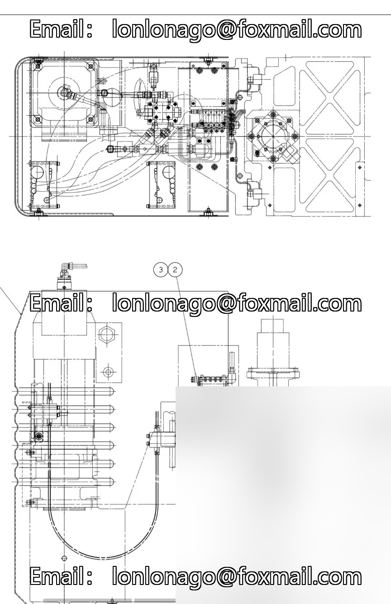
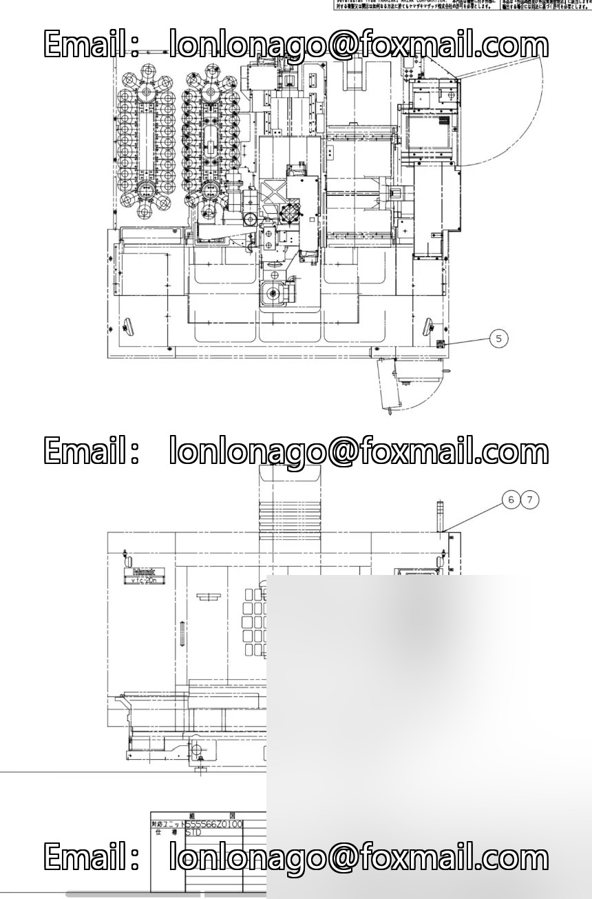
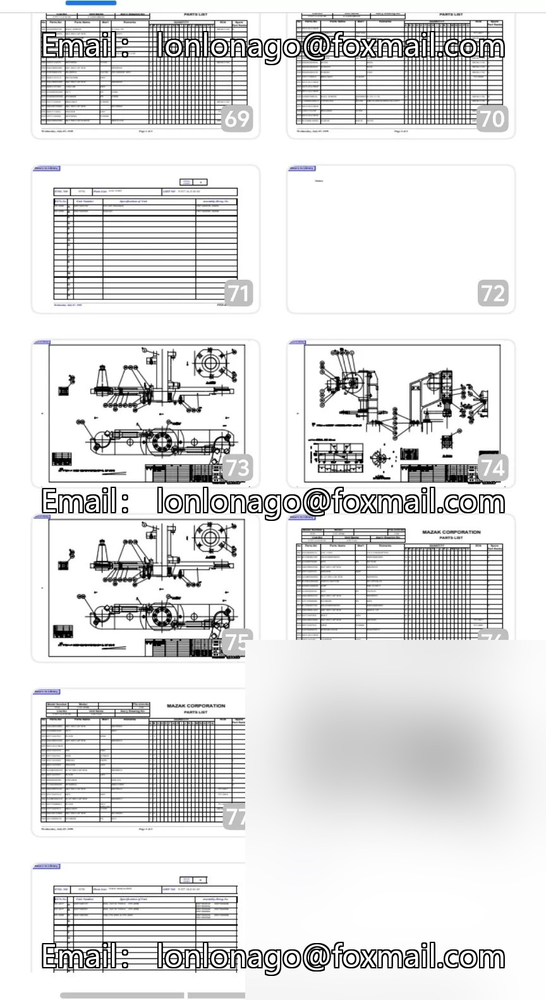
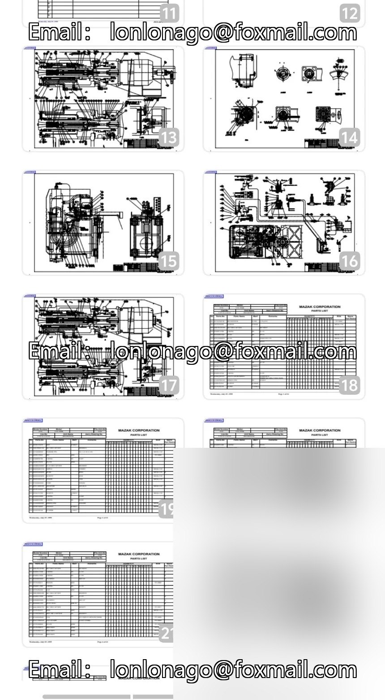

# Mazak Makaz VTC-200B CNC lathe mechanical part manual PDF

## Body

Mazak VTC-200B CNC lathe mechanical part manual PDF file, 240 pages.
PDF , content includes mechanical structures, part numbering, system principle diagrams, etc., suitable for professional uses such as maintenance, spares procurement, and system maintenance.
Can be directly photographed, and have private chat if there are issues.
It belongs to the core machine model of the Yamazaki Mazak (Yamaji Mazak) VTC series, released around the 1999-2000 era, with the positioning of a medium-sized vertical processing center, its main characteristic is the "fixed worktable + mobile column" structure, which is different from a general VMC (worktable mobile).
1812

The manual provides manuals and parts information for the Mazak VTC-200B CNC lathe, including mechanical structures, part numbers and system principle diagrams, suitable for professional repair, spare parts purchasing and system maintenance.

<!-- AI_ENRICHED -->

## Images

## Payment

Here is a pay link on Stripe ( https://buy.stripe.com/3cs8yP7sY87d0vu9AB ). Please contact me lonlonago@foxmail.com after funding $89, and I will send you a complete data files , thank you!

